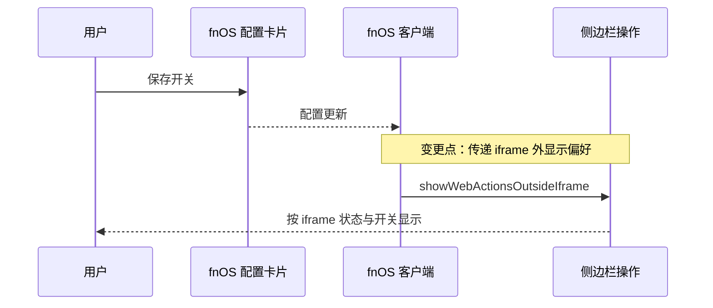
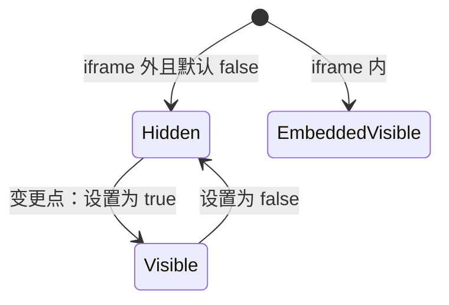

# PLAN-FNOS-049 iframe 外显示刷新与重启入口

| 项目 | 内容 |
| --- | --- |
| 计划编号 | PLAN-FNOS-049 |
| 计划日期 | 2026-11-09 |
| 对应需求 | [FNOS-049](/requirements/FNOS-049-standalone-web-actions) |
| 计划状态 | 待完成（工程检查完成，目标环境未验收） |

## 计划目标

实现 FNOS-049-01、FNOS-049-02。在既有 fnOS 插件详情配置卡片中用 Semi 开关暴露默认关闭的布尔设置，沿用官方 Config schema 与字段级持久化，不增加重启接口或调整网关权限。

## 当前实现与目标设计

| 领域 | 当前实现 | 目标实现 | 迁移影响 |
| --- | --- | --- | --- |
| 入口显示 | `FnosWebRestartAction` 在 iframe 外返回空 | iframe 内继续显示，外部由 `showWebActionsOutsideIframe` 控制 | 缺字段等同 false |
| 配置 | 现有 fnOS 自定义配置区；基线尚无客户端自动表单渲染器 | 新增布尔 schema，默认 false；配置卡片使用 Semi 开关，保存后通过快照订阅更新动作组件 | 不迁移已有设置 |
| 操作 | 刷新当前页面；通过网关重启 Web | 保持处理及错误状态 | 不改变权限 |

原行为与验收参考 [FNOS-002-04](/requirements/FNOS-002-dsh-app-plugin-optimization#功能列表)，重启后代理凭据恢复保持 [FNOS-004-05](/requirements/FNOS-004-dsh-015-rc2-adaptation#功能列表) 的约定；不修改已完成文档。

## 影响范围分析

| 需求功能 | 代码模块 | 配置/数据 | 测试 | 文档 | 目标环境 |
| --- | --- | --- | --- | --- | --- |
| FNOS-049-01 | `plugins/dsh-fnos-plugin` 的 Config、客户端配置区与 `FnosWebRestartAction` | `showWebActionsOutsideIframe`，默认 false | schema 默认值、配置接入、iframe 内外显示矩阵 | 插件说明、需求、计划、测试及索引菜单 | DSH Web、真实 fnOS NAS |
| FNOS-049-02 | 既有刷新和重启处理 | 无权限或凭据变化 | 操作回归、失败反馈 | Manifest 及测试记录 | 真实 fnOS NAS |

## 架构与数据流

既有 fnOS 配置卡片通过共享包 Semi 开关编辑布尔设置，使用官方 `ConfigForm.set` 字段级持久化；客户端订阅配置快照并将保存值传入既有侧边栏动作，保持 slot id 与 priority。Host 保留 `auto: false`，旧字段不新增隐藏标记。

iframe 内的状态不由新设置切换，iframe 外的显示状态可逆。

## 分阶段任务

| 任务 ID | 对应需求/验收 | 修改内容 | 前置条件 | 验证方式 |
| --- | --- | --- | --- | --- |
| PLAN-FNOS-049-T01-01 | FNOS-049-01 / AC-01、AC-03 | Config 新增默认 false 字段，并接入现有 fnOS 配置卡片 | 需求与计划建立 | 默认值与旧配置契约检查 |
| PLAN-FNOS-049-T01-02 | FNOS-049-01 / AC-02 | 客户端传递配置，动作组件按 iframe 或开启值显示；补多语言文案 | T01-01 | 显示矩阵、配置更新与持久化验证 |
| PLAN-FNOS-049-T02-01 | FNOS-049-02 / AC-01 | 回归刷新、重启和失败反馈 | T01-02 | 插件检查、构建与真实 NAS 走查 |
| PLAN-FNOS-049-T03-01 | FNOS-049-01 / AC-01～03；FNOS-049-02 / AC-01 | 回填测试结果、说明及 Manifest，独立推进版本 | 前述实现完成 | SDD、文档构建、全仓检查及版本一致性 |

任一步验证失败均保留未完成状态，回退本需求改动，不删除用户配置、凭据或会话。

## 交互和行为设计

设置位于 fnOS 插件详情页的现有配置卡片，显示名称说明“iframe 外显示刷新与重启按钮”，默认关闭。保存后配置更新控制宽侧栏与折叠侧栏；iframe 内始终保持显示。沿用既有忙碌、失败反馈和按钮文案；设置说明明确重启需要 fnOS 网关。

## 数据、权限和错误处理

只有一个布尔配置，无敏感数据；缺字段按 false。显示开关不赋予权限。继续既有同源网关请求和失败反馈，不新增直连重启服务或凭据处理。旧配置和用户其他设置保持兼容。

## 依赖、风险和决策

已核实 DSH 0.2.2-rc.1 的 `dsh-settings` README 第 39 行明确说明尚无已发布客户端提供自动 schema 表单；`describe.autoGenerate` 仅是元数据，不能保证控件出现。因此不把自动表单作为交付依赖：按[插件 UI 规范](/charter/plugin-ui-standards#配置项-ui-选择顺序)中官方配置 UI 不满足时使用自定义配置区的规则，在既有卡片中加入共享包 Semi 开关，保留官方 Config schema 和 `ConfigForm.set` 字段级保存，并订阅快照。该决策保持现有基线与其他字段的配置入口。直接访问 DSH 上游可能没有网关重启接口，应如实显示既有失败状态；不扩大本需求为网络路由改造。

## 测试、打包、发布和回滚

执行插件 typecheck、单元测试和 build，覆盖配置默认值及 iframe 内外矩阵。执行 `pnpm run check -- --sdd --docs`、`pnpm run check -- --all`、`pnpm run build -- --docs` 与 `git diff --check`。UI 走查覆盖亮暗主题、宽与折叠侧栏。

真实 NAS 验证 iframe 与独立网关页面中的默认、开启、关闭、持久化，以及刷新重启回归；通过正常 FPK 安装升级路径，不改已安装应用文件。测试用例和执行结果统一写入 [FNOS-049 测试用例](/tests/FNOS-049-standalone-web-actions)，未执行如实登记。

功能改动提交后，在干净工作区使用 `pnpm run version -- minor --yes` 统一推进至 8.2.0，单独版本提交；如会话版本通道已冻结，先同步目标版本。仅 PR 不推送 tag、不发布 npm。装机验证如需中间换号按 patch 规则执行。失败可回退本需求提交或关闭开关，保留凭据、会话及其他用户设置。

## 参考资料

- [需求文档规范](/charter/requirements-spec)
- [插件开发](/development/plugin-development)
- [插件 UI 规范](/charter/plugin-ui-standards)
- [版本管理](/build/versioning)
- [测试用例规范](/charter/tests-spec)

## 完成状态

配置与显示实现、单元测试和工程验证已完成：fnOS 插件 48 个测试文件、472 条测试，全仓 12 个包共 2030 条测试通过；typecheck、SDD、i18n、文档与插件构建均通过。相关 ESLint 退出码 0，UI 组件仅保留 AuthorizedCard 原有 3 条 JSDoc warning。真实浏览器交互及真实 NAS 的 8 条验收用例未执行，计划保留待完成状态。版本与 PR 由后续流程处理，实际证据见测试记录。

## 变更记录

| 日期 | 变更 |
| --- | --- |
| 2026-11-09 | 建立默认 false 的 `showWebActionsOutsideIframe` 接入计划，保留原操作及权限；目标版本 8.2.0，验证待执行 |

| 2026-11-09 | 核实基线未提供客户端自动表单渲染器，改用既有配置卡片的 Semi 开关，保留官方 schema、字段级保存及快照订阅；工程检查完成，真实浏览器与真实 NAS 交互未执行 |

| 2026-11-09 | 回填最终工程验证：fnOS 472 条、全仓 2030 条测试通过，相关检查与构建通过；8 条真实交互用例尚未执行，目标环境待验收 |
