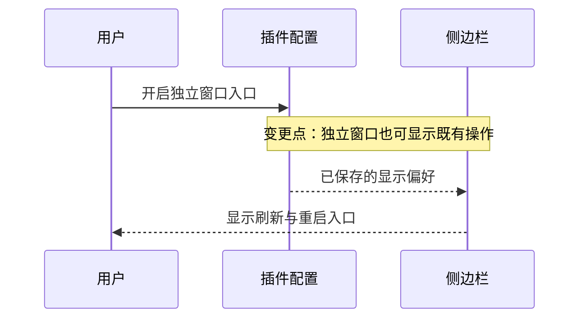

# FNOS-049 iframe 外显示刷新与重启入口

| 项目 | 内容 |
| --- | --- |
| 需求编号 | FNOS-049 |
| 提出日期 | 2026-11-09 |
| 需求状态 | 待验收（工程检查完成，真实交互未执行） |
| 关联计划 | [PLAN-FNOS-049](/plans/PLAN-FNOS-049-standalone-web-actions) |

## 需求背景

fnOS 插件目前只在 iframe 内显示侧边栏的刷新与重启入口。用户在独立窗口打开应用时，希望能主动显示相同入口，同时保留旧用户的默认行为。

## 调研结论

| 结论 | 出处 | 影响的功能 | 状态 |
| --- | --- | --- | --- |
| 既有刷新作用于当前 DSH 页面；重启依赖 fnOS 网关，显示入口不代表获得重启权限 | fnOS 插件现行行为及 [FNOS-002-04](/requirements/FNOS-002-dsh-app-plugin-optimization#功能列表) | FNOS-049-01、FNOS-049-02 | 已核实 |

## 需求目标

用户可以在 fnOS 插件详情页的现有配置卡片中主动开启独立窗口的刷新与重启入口；未开启时维持现状。

## 功能列表

| 编号 | 优先级 | 功能 | 用户可观察结果 | 状态 |
| --- | --- | --- | --- | --- |
| FNOS-049-01 | P1 | 独立窗口入口显示设置 | 默认关闭；开启后 iframe 外显示刷新与重启，关闭后隐藏；iframe 内始终保持显示 | 实施中 |
| FNOS-049-02 | P1 | 保持刷新重启行为 | 刷新只重载当前页面；重启沿用网关处理与失败反馈 | 待验证 |

## 行为约束

- 旧用户没有保存该设置时按关闭处理，升级不主动显示额外入口。
- 设置在保存及重新打开页面后保留；更改设置后侧边栏随配置更新。
- iframe 内是否显示不受该设置影响；宽侧栏与折叠侧栏行为一致。
- 入口可见性不改变网关鉴权、权限或宿主能力。
- 对 [FNOS-002-04](/requirements/FNOS-002-dsh-app-plugin-optimization#功能列表) 的扩展为“原有嵌入入口继续显示，独立窗口可主动开启”，不改写原验收记录。

独立窗口新增可逆的显示状态；iframe 内保持既有显示结果。

设置只扩展入口的显示范围，操作本身仍遵循既有行为。

## 不在本次范围内

不提供独立的重启服务，不保证绕过 fnOS 网关的直连入口可重启，不修改快捷键、文件授权、主题桥接及已有网关恢复流程。

## 验收条件与完成状态

| 编号 | 可观察结果 | 目标环境 | 状态 |
| --- | --- | --- | --- |
| FNOS-049-01-AC-01 | 未保存设置或关闭时，独立窗口隐藏入口；iframe 内显示入口 | DSH Web、真实 fnOS NAS | 未执行 |
| FNOS-049-01-AC-02 | 开启后独立窗口显示入口，关闭后隐藏；宽与折叠侧栏一致 | DSH Web、真实 fnOS NAS | 未执行 |
| FNOS-049-01-AC-03 | 保存并重新打开页面后设置保留，升级旧设置默认关闭 | DSH Web、真实 fnOS NAS | 未执行 |
| FNOS-049-02-AC-01 | 刷新只重载当前页面，重启在网关入口恢复页面；不可用时反馈失败 | 真实 fnOS NAS | 未执行 |

## 变更记录

| 日期 | 变更 |
| --- | --- |
| 2026-11-09 | 建立需求，新增默认关闭的独立窗口入口设置，保持 iframe 内显示和既有操作语义；目标版本 8.2.0 |
| 2026-11-09 | 实现及工程检查完成，真实浏览器与真实 NAS 的 8 条交互验收用例未执行，需求转为待验收 |
